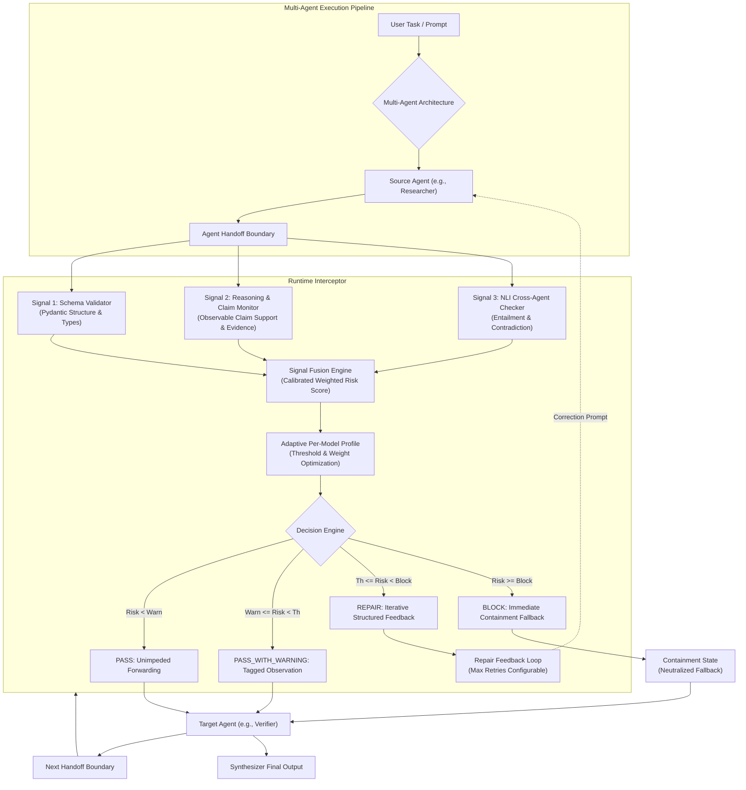
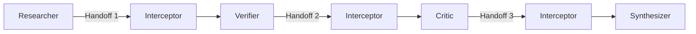
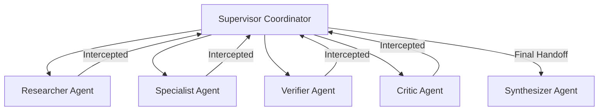
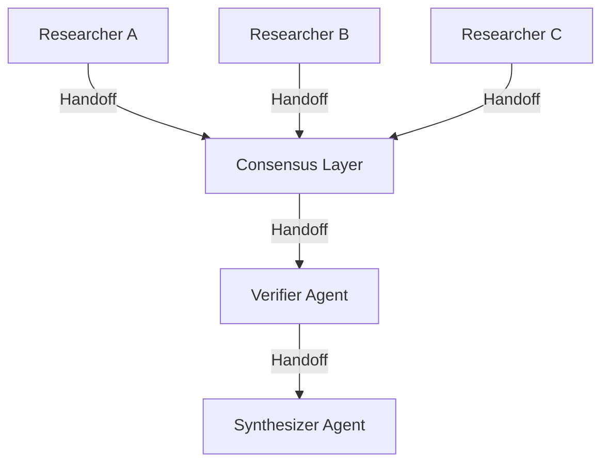

# Architecture Specification

## 1. System Overview
The Runtime Interceptor is an adaptive, architecture-aware middleware layer designed to operate at multi-agent LLM handoff boundaries. It prevents error propagation by intercepting structured observable reasoning artifacts between agents, evaluating them across three orthogonal detection signals, computing an adaptive composite risk score, and executing containment or repair actions.



---

## 2. Multi-Agent Orchestration Topologies

The interceptor evaluates three distinct LangGraph orchestration topologies:

### Topology A: Sequential Chain


### Topology B: Hierarchical Supervisor


### Topology C: Parallel-Consensus Architecture


---

## 3. Observable Structured Reasoning Schema
To prevent dependence on hidden chain-of-thought, all agent outputs strictly follow observable structured reasoning:

```json
{
  "answer": "Primary factual response or domain synthesis",
  "claims": [
    {
      "claim": "Atomic observable factual assertion",
      "confidence": 0.95,
      "evidence": ["Observable ground truth reference or premise"]
    }
  ],
  "assumptions": ["Explicit domain or environmental assumptions"],
  "sources": ["Named external citations or authoritative repositories"]
}
```
